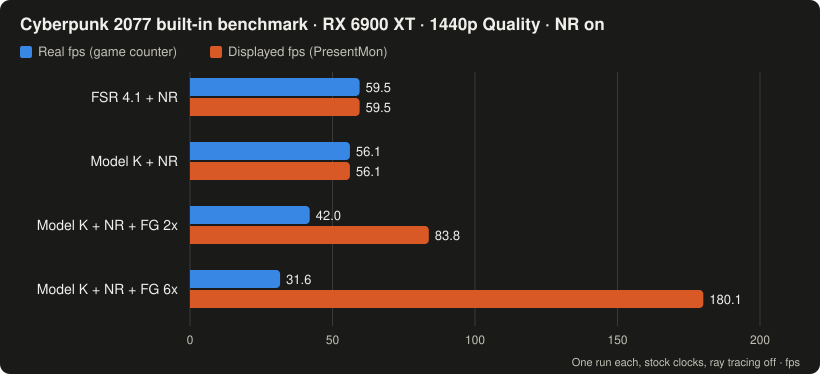
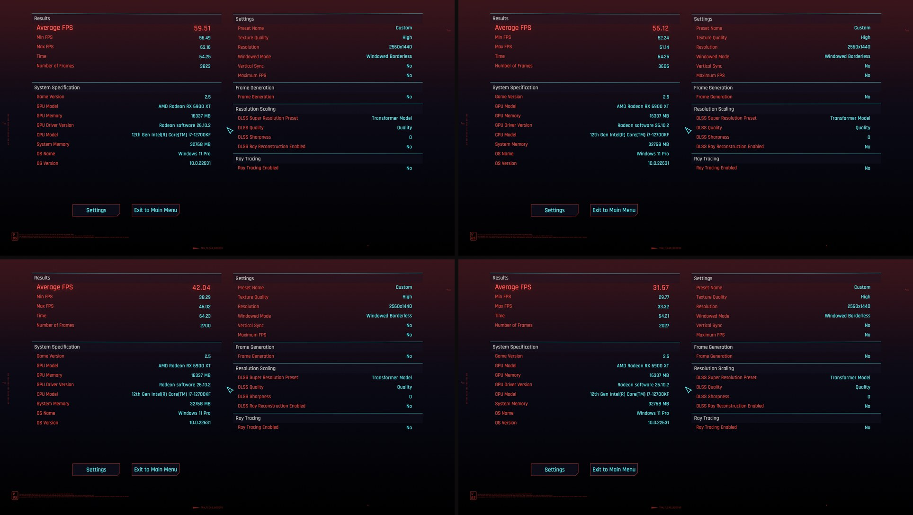
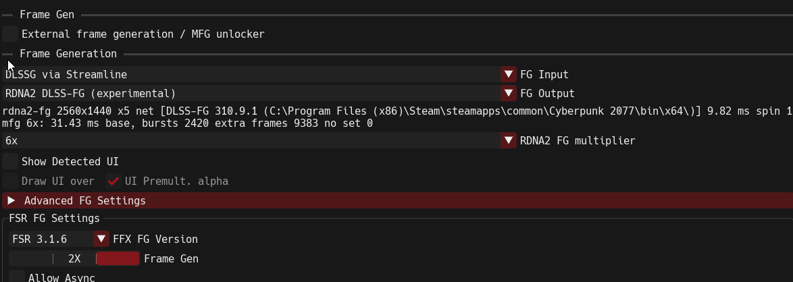

<h1 align="center">HexNeural</h1>

<b>DLSS 5 Neural Rendering · DLSS Super Resolution Model K / M · DLSS 4 Frame Generation on AMD Radeon RX 6000 (RDNA2), on our own GPU kernels.</b>

<a href="../../releases/latest"><b>Download v1.0.0</b></a> ·
<a href="CHANGELOG.md">Changelog</a> ·
<a href="#is-it-safe">Is it safe?</a> ·
<a href="#install">Install</a> ·
<a href="LICENSE">GPL-3.0</a>

RX 6000 cards have no Tensor Cores, no FP8 and no AI units. HexNeural runs NVIDIA's DLSS networks on them anyway:
every layer is re-implemented in our own HIP kernels for RDNA2, and the networks plug into games through OptiScaler
(our [OpenNR fork](https://github.com/philippraschke75-spec/OpenNR-OptiScaler/tree/release)).
NVIDIA's weights are read from DLLs you already own and never leave your PC.

**1.0.0 is our biggest release so far, and it is no longer experimental.** Three DLSS features in one package, tested
together in game on an RX 6900 XT:

| | What it does | RX 6900 XT |
|---|---|---|
| **DLSS 5 Neural Rendering (NR)** | NVIDIA's neural re-rendering: light, skin, materials, contrast | 10.8 ms network at 960p |
| **DLSS SR Model K** (and Model M) | NVIDIA's transformer upscaler | **2.36 ms** at 1440p Quality |
| **DLSS 4 Frame Generation** | NVIDIA's frame generation networks, **2x up to 6x** | 180 fps displayed in Cyberpunk at 6x |

> **Coming to OpenNR:** our RDNA2 runtime is being added to [OpenNR](https://github.com/MatheusFerreiraS/OpenNR-OptiScaler) within the next few hours.
> **AMDNR** (the community project, not AMD) plans to ship our port with its **v3.5.6** release.

## In-game results

| Cyberpunk 2077 built-in benchmark, 1440p Quality, NR on | Real fps | Displayed fps |
|---|---|---|
| FSR 4.1 + NR | 59.5 | 59.5 |
| DLSS Model K + NR | 56.1 | 56.1 |
| DLSS Model K + NR + DLSS 4 FG 2x | 42.0 | **83.8** |
| DLSS Model K + NR + DLSS 4 FG 6x | 31.6 | **180.1** |

RX 6900 XT, stock clocks, i7-12700KF, Radeon Software 26.10.2, game 2.5, ray tracing off, one run each.
The game's counter only sees real frames; displayed fps (real + generated) were recorded with PresentMon.

## Offline network times

Pure network time on an RX 6900 XT, measured with our offline benches (no game running):

| Network | Resolution | Time |
|---|---|---|
| DLSS 5 NR (310.9.16 model, full ViT every frame) | 2560x1440 native | 20.4 ms |
| DLSS 5 NR | 1707x960 (1440p Quality) | 10.8 ms |
| DLSS SR Model K | 1706x960 -> 2560x1440 | **2.36 ms** |
| DLSS SR Model M | 1706x960 -> 2560x1440 | ~11.6 ms (slow on RDNA2) |
| DLSS 4 FG, DL1 network (once per real frame) | 2560x1440 | 0.73 ms |
| DLSS 4 FG, DL2 network (per generated frame) | 2560x1440 | 0.61 ms |
| DLSS 4 FG, rest of the pipeline (real + one generated frame) | 2560x1440 | ~1.17 ms |

**Accuracy:** our generated frames match NVIDIA's own (captured on an RTX 5070 Ti from the same game frames) at **63-66 dB**.
For comparison, AMD's FSR 4.1.2 upscale takes 1.41 ms on the same card: Model K is the choice for the DLSS look, FSR 4.1 is still the faster upscaler.

## Screenshots

<i>DLSS 5 NR off (left) vs on (right), Cyberpunk 2077, 1440p, RX 6900 XT.</i>

 
<i>Overlay (Insert): DLSS-G input, RDNA2 DLSS-FG output at 6x, with the live status line.</i>

## Does my PC work?

| | |
|---|---|
| Graphics card | AMD **RX 6000** (RDNA2): RX 6400 / 6500 XT / 6600 (XT) / 6650 XT / 6700 (XT) / 6750 XT / 6800 (XT) / 6900 XT / 6950 XT. RX 7000/9000, NVIDIA, Intel and iGPUs are refused. |
| Windows | Windows 10 or 11, 64-bit |
| Driver | A recent AMD Adrenalin driver. It already contains the HIP runtime (`amdhip64_6.dll`); **no ROCm or HIP SDK install** |
| Game | A DirectX 12 game with DLSS (for Frame Generation: DLSS Frame Generation) |

Tested on the RX 6900 XT. The other RDNA2 chips (gfx1031, gfx1032, gfx1034) run the same code, built for each chip.

## Install

**Coming from v0.5.2?** Run its `Uninstall_DLSS5.bat` in the game folder first. 1.0.0 uses a new layout.

1. Download `HexNeural-1.0.0.zip` from [Releases](../../releases/latest) and check its SHA-256 (listed in the release notes).
2. Copy everything inside `HexNeural-1.0.0\` into the folder with the game's `.exe` (Cyberpunk: `Cyberpunk 2077\bin\x64`).
3. Copy your own NVIDIA DLLs into the same folder. They are **not included** and never will be:

   | Feature | File | Version |
   |---|---|---|
   | Neural Rendering | `nvngx_dlssnr.dll` | 310.8 or 310.9.16 |
   | Model K / M | `nvngx_dlss.dll` | 310.5 or newer |
   | Frame Generation | `nvngx_dlssg.dll` | 310.9.1 |

4. Model K / M only, once: convert the models from your own `nvngx_dlss.dll` (stays on your PC):
   `powershell -ExecutionPolicy Bypass -File WrongGPU\setup_wronggpu.ps1 -Game "<game exe folder>"`
5. Start the game and pick **DLSS** in its graphics menu. Press **Insert** for the overlay:
   - **Upscaler:** `DLSS Model K` (default), `DLSS Model M (slow on RDNA2)` or FSR.
   - **DLSS Neural Rendering:** on by default. The "RDNA2 network" section sets ViT skip and network resolution.
   - **Frame Generation:** turn on DLSS Frame Generation in the game; it follows the game's setting.
     For up to **6x**, switch Frame Gen on in the overlay and pick the **RDNA2 FG multiplier** (2x-6x).

**Uninstall:** delete the package files from the game folder (`dxgi.dll`, `OptiScaler.ini`, `OptiScaler\`, `Rdna2*`,
`nr_runtime.dll`, `nr_data_h15\`, `fg*`, `WrongGPU\`). If a game file was replaced, use Steam's "Verify integrity of game files".

## Is it safe?

- **No installer, no admin rights, no background service.** You copy files into a game folder. The only script is WrongGPU's
  model converter (step 4); it reads your `nvngx_dlss.dll` and writes the converted model into `WrongGPU\`.
- **Nothing is downloaded or uploaded** by our runtimes. They read the game's frames and your NVIDIA DLLs, nothing else.
- **Open source:** the OptiScaler fork ([branch `release`](https://github.com/philippraschke75-spec/OpenNR-OptiScaler/tree/release)),
  the NR runtime and OpenNR adapter ([`src/`](src)), and [WrongGPU](https://github.com/phantoslayer21/wronggpu), which Model K/M builds on.
- **Every file has a SHA-256** in `SHA256SUMS.txt` inside the ZIP, and the ZIP's own hash is in the release notes.
- **No NVIDIA files** are in the package: no DLLs, weights or converted models.

| File | What it is |
|---|---|
| `dxgi.dll`, `OptiScaler.ini`, `OptiScaler\` | OptiScaler (OpenNR fork): hooks the game's upscaler and frame generation, the Insert overlay |
| `Rdna2NrRuntime.dll`, `Rdna2NrRuntime.ini`, `nr_runtime.dll`, `nr_data_h15\` | DLSS 5 NR: adapter, HIP runtime and our compiled kernels |
| `Rdna2FgRuntime.dll`, `Rdna2FgNet.dll`, `fgnets.dll`, `fg_pipeline.dll`, `fg_pipeline_gfx1030.hsaco` | DLSS 4 Frame Generation: runtime, networks and pipeline kernels |
| `WrongGPU\` | Model K / M upscaler front end, runtime and model converter (based on WrongGPU, MIT) |

## Known limits

- **Model M is slow on RDNA2** (~11.6 ms at 1440p Quality). Use Model K.
- **Frame Generation costs real frames:** at 6x the real frame rate drops more than at 2x (31.6 vs 42.0 fps above). Pick the multiplier that fits your screen.
- The NR "split network" mode is off and greyed out in the overlay (it trailed in motion).
- Do not use it in online games with anti-cheat.

**Something wrong?** The logs are in the game folder: `OptiScaler.log`, `Rdna2NrRuntime.log`, `Rdna2FgRuntime.log` and
`WrongGPU\wronggpu-fsr.log`. Open an [issue](../../issues) and attach them.

## Who made what

| Part | By |
|---|---|
| The networks and their weights (DLSS NR, SR, FG) | **NVIDIA**, read from your own `nvngx_*.dll` |
| Running them on RX 6000: NR runtime and kernels, FG runtime, networks and pipeline, Model K/M speed-ups | **HexNeural** (this project) |
| Model K / M runtime base | [WrongGPU](https://github.com/phantoslayer21/wronggpu) by Devin (phantoslayer21), MIT. *Parts based on WrongGPU (github.com/phantoslayer21/wronggpu), MIT.* |
| Game integration | [OptiScaler](https://github.com/optiscaler/OptiScaler) and [OpenNR](https://github.com/MatheusFerreiraS/OpenNR-OptiScaler) |

DLSS and NVIDIA are trademarks of NVIDIA Corporation; FidelityFX and Radeon are trademarks of AMD.
HexNeural is not affiliated with or endorsed by NVIDIA or AMD.

## License

[GPL-3.0](LICENSE). WrongGPU parts: MIT. Third-party licenses are in `Licenses\` in the ZIP.
