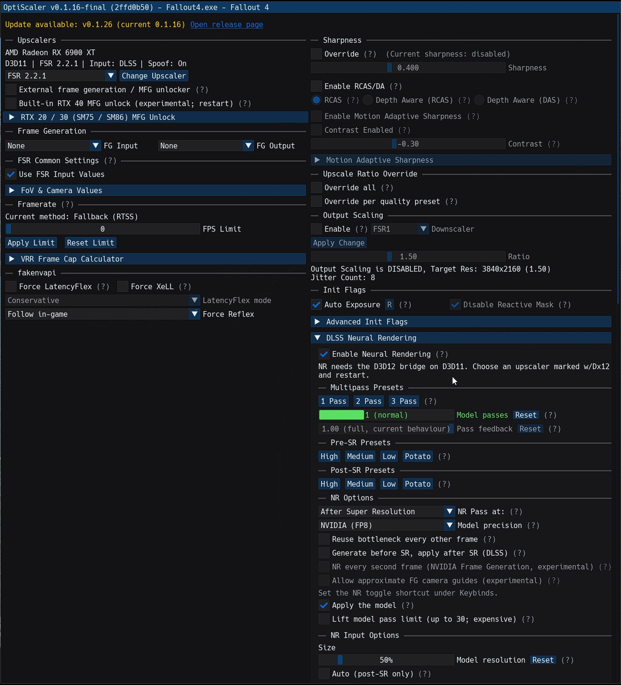

# DLSS 5 Neural Rendering auf AMD-RX-6000-Karten (experimentell)

**English:** [README.md](README.md)

<i>Cyberpunk 2077, 1440p, FSR 4.1 Qualität, RX 6900 XT, v0.5 Standard (Hybrid_1440). Links aus, rechts an. ~35 FPS.</i>

Technische Details (Netzarchitektur, Kernel, Performance): siehe [README.md](README.md#how-it-works-technical).

**Kein HIP SDK und kein ROCm nötig.** Die HIP-Laufzeit (`amdhip64_6.dll`) kommt mit dem normalen AMD-Adrenalin-Treiber. Du brauchst nur einen aktuellen Treiber, die ZIP und NVIDIAs `nvngx_dlssnr.dll`.

## Was ist das?

NVIDIA hat eine neue Grafik-Funktion gebaut: **DLSS Neural Rendering** („DLSS 5“). Damit sehen Spiele
realistischer aus: besseres Licht, mehr Details, schönere Farben. Normalerweise geht das **nur mit
NVIDIA-Grafikkarten**.

Diese Mod bringt es auf **AMD-Radeon-RX-6000-Karten** (RDNA2).

> **Experimentell.** Kann abstürzen, falsch aussehen oder viele FPS kosten. Nicht in Online-Spielen
> mit Anti-Cheat benutzen.

**Neu in v0.5.2:** Netz bei 1440p ~14 % schneller (schnellere FP8-Nachbildung, Kernel-Tuning), 71-85 % weniger weiß springende Pixel (`split_fade=5`). Details: [CHANGELOG.md](CHANGELOG.md).

**Neu in v0.5: der echte DLSS-5-Look.**
- Frühere Versionen haben die Detail-Teile des Netzes in 720p/540p gerechnet, also mit einem Viertel von NVIDIAs Pixeln, deshalb wirkte der Effekt schwach. **v0.5 rechnet sie in deiner Ausgabe-Auflösung** (Hybrid-Modus, Standard): etwa **3x** der Effekt von v0.4 in Cyberpunk bei 1440p.
- **Ghosting behoben** in Spielen mit Upscaler (Bewegungsvektoren waren falsch skaliert), **sauberes `nr_split`** (Ergebnisse werden eingeblendet), **Absturz behoben** beim Neuaufsetzen von NR.
- **Cyberpunk 2077, 1440p, FSR 4.1 Qualität, RX 6900 XT:** etwa **35 FPS** mit vollem Look (`Hybrid_1440`), etwa **45 FPS** mit `Hybrid_1440_Fast`.
- Neue Presets: `Hybrid_1440` (Standard), `Hybrid_1440_Fast`, `Hybrid_1080`, `Hybrid_4K`, `Full_1440`, `Full_1080`. Alte Presets in `presets/classic`.
- Vollständige Liste und Performance-Tabelle: [Release-Notes](../../releases/tag/v0.5) und [CHANGELOG.md](CHANGELOG.md).

**Neu in v0.4:**
- **NVIDIAs neues DLSS-5-Modell** (nvngx_dlssnr.dll 310.9.16) wird automatisch genutzt: etwa **halb so schwer**, ~10 ms pro Netz-Durchlauf bei 960x540 auf einer RX 6900 XT (v0.3: 24 ms). Die alte 310.8 läuft weiter mit dem alten Modell.
- **Cyberpunk 2077, 1440p, FSR Qualität, ohne Frame Generation, RX 6900 XT:** 54,7 FPS auf Hoch, 85,3 FPS auf Niedrig (v0.3: 43,8 FPS auf Hoch; danielblnc v0.6.0 auf derselben Karte: 21,7 FPS).
- **Bild viel näher an NVIDIA** (+6-8 dB zur Referenz; 4 Netz-Fehler behoben), NVIDIAs Standard-Look, und die **OptiScaler-NR-Regler funktionieren** (Intensity, Style, Tone, Structure, Skin).
- **Viel weniger Flackern** (`edit_temporal`, -90 %), Netz auf 3 Frames verteilt für gleichmäßigere, höhere FPS.
- **Looks zur Auswahl** (`presets\`): Standard, Strong, Cinematic, HighQuality_720p, HiRes_1080p, Native_1440p, Performance, Community.
- **Netz-Auflösungen bis 1080p / 1440p** für mehr Feindetail (kostet FPS).
- Alle Kernels sind unser eigener Code; keine NVIDIA-Daten im Paket. Alles im Detail: [CHANGELOG.md](CHANGELOG.md).

**Neu in v0.3.1:** nutzt die richtige GPU (nie die iGPU), VRAM-Leck behoben, HDR-Auto-Belichtung, sauberes Abschalten
bei unbekannter `nvngx_dlssnr.dll`, alle Kernel selbst geschrieben, etwas schneller und weniger VRAM.

**Neu in v0.3:** bis zu 60 FPS ohne Frame Generation auf einer RX 6900 XT, gleichmäßige Frametimes, kein Stottern
mehr in schnellen Spielen, HDR-Fix (keine weißen Figuren mehr), saubere 2 Durchgänge, sicheres Setup mit Backup und Deinstaller.
Siehe [CHANGELOG.md](CHANGELOG.md).

## Geht das auf meinem PC?

Du brauchst **alles** davon:

| | |
|---|---|
| ✅ Grafikkarte | AMD **RX-6000-Serie**, siehe Tabelle unten. RX 7000/9000, NVIDIA und Intel gehen **nicht**. |
| ✅ Windows | Windows 10 oder 11, 64-Bit |
| ✅ AMD-Treiber | Ein aktueller AMD-Adrenalin-Treiber ([Download](https://www.amd.com/de/support/download/drivers.html)) **Sonst nichts:** kein HIP SDK, kein ROCm. Mit einem sehr alten Treiber bleibt NR einfach aus (das Spiel läuft weiter); im Log steht dann `cannot load nr_runtime.dll`. |
| ✅ Spiel | Ein 64-Bit-Spiel mit DirectX 11 oder 12, in dem du in den Grafikeinstellungen **DLSS, FSR oder XeSS** auswählen kannst |
| ✅ NVIDIA-Modelldatei | `nvngx_dlssnr.dll`. **Nicht dabei**, die musst du dir selbst besorgen (Schritt 2) |

| Grafikkarte | Status | Zeit pro Modell-Frame |
|---|---|---|
| RX 6900 XT / 6950 XT | ✅ getestet | ~10 ms (gemessen) |
| RX 6800 / 6800 XT | ✅ läuft (User-Berichte) | ~11-14 ms (geschätzt) |
| RX 6700 / 6700 XT / 6750 XT | ✅ läuft (User-Berichte) | ~18-20 ms (geschätzt) |
| RX 6600 / 6600 XT / 6650 XT | ✅ läuft (User-Berichte) | ~25-30 ms (geschätzt) |
| RX 6500 XT / 6400 | 🧪 sollte gehen, langsam | 50 ms+ (geschätzt) |

**v0.4 läuft auf der ganzen RX-6000-Familie (RDNA2).** Erste User-Berichte liegen im Schnitt bei **etwa 55 FPS** im Spiel.

Weitere Berichte gern in [Issues](../../issues) (mit deiner `dlssnr_nr.log`, darin stehen GPU und Zeiten).

Du weißt nicht, welche Grafikkarte du hast? Drück `Strg + Umschalt + Esc`, klick auf **Leistung**, dann
auf **GPU**. Der Name steht oben rechts.

## Installation

### Schritt 0: Spielordner vorher sichern

Kopier deinen ganzen Spielordner an einen sicheren Ort (zum Beispiel auf den Desktop). Wenn etwas schiefgeht, kopierst du ihn zurück.

### Schritt 1: Herunterladen

Geh zu [**Releases**](../../releases/latest) und lade die ZIP (`DLSS5-RDNA2-Experimental-...zip`) herunter. Alle RX-6000-Karten nutzen dieselbe (neueste) ZIP.

### Schritt 2: NVIDIA-Modelldatei besorgen

Diese Mod enthält **keine** NVIDIA-Dateien. Du brauchst die Datei **`nvngx_dlssnr.dll`** (ca. 160 MB).
Wo du sie bekommst, steht in janblades Anleitung:
[Choose the correct runtime](https://github.com/janblade/OptiScaler-DLSSNR-PreSR-Multipass/blob/main/INSTALL-DLSSNR.md#choose-the-correct-runtime).

### Schritt 3: Spielordner finden

Das ist der Ordner, in dem die **echte 64-Bit**-`.exe` des Spiels liegt, also die, die das Spiel wirklich startet.
Das ist **nicht** immer der Hauptordner: Viele Spiele haben oben nur einen kleinen Launcher und die echte
Spiel-`.exe` weiter unten.

- **Steam:** Rechtsklick aufs Spiel → **Verwalten** → **Lokale Dateien durchsuchen**
- **Epic / GOG / andere:** Rechtsklick aufs Spiel → Installationsordner öffnen

Schau zuerst in diese Unterordner. Liegt die Spiel-`.exe` in einem davon, nimm **diesen** Ordner:

| Ordner-Muster | Beispiel |
|---|---|
| Hauptordner (kein Launcher) | `...\Fallout 4\` (mit `Fallout4.exe`) |
| `bin\` oder `bin\x64\` | `...\Cyberpunk 2077\bin\x64\` (mit `Cyberpunk2077.exe`) |
| `x64\` | `...\Spielname\x64\` |
| `<Name>\Binaries\Win64\` (Unreal-Spiele) | `...\Jedi Survivor\SwGame\Binaries\Win64\` |

Tipp: Spiel starten, Task-Manager → **Details**, Rechtsklick auf den Spielprozess → **Dateipfad öffnen**.
Das ist genau der richtige Ordner. `setup_windows.bat` warnt, wenn im Ordner keine 64-Bit-`.exe` liegt.

### Schritt 4: Dateien kopieren

1. Öffne die ZIP aus Schritt 1.
2. Kopiere **alles** daraus in den Spielordner. Wenn Windows fragt: **Ersetzen**.
3. Kopiere `nvngx_dlssnr.dll` aus Schritt 2 in denselben Spielordner.

### Schritt 5: Setup starten

Doppelklick im Spielordner auf **`setup_windows.bat`**. Ein schwarzes Fenster stellt ein paar Fragen:

> ⚠️ **Du nutzt ReShade oder ENB?** Dann **niemals** überschreiben. Wenn das Skript „overwrite?“ fragt, antworte `2` und wähle `2` (`winmm.dll`). Überschreiben löscht die ReShade-/ENB-Datei, und das Spiel startet evtl. nicht mehr.

| Frage | Eingabe |
|---|---|
| „Do you want to delete these files?“ (nur wenn ein altes OptiScaler da ist) | `1` + Enter |
| „Choose a filename for OptiScaler“ | nur Enter (= `dxgi.dll`) |
| „dxgi.dll already exists … overwrite?“ (du nutzt ReShade o. Ä.) | `2` + Enter, dann `2` (`winmm.dll`) |
| „Are you using an Nvidia GPU or AMD/Intel GPU?“ | `1` + Enter (AMD) |

Wenn das Fenster fertig ist, schließ es.

### Schritt 6: Spiel starten

1. In den Grafikeinstellungen des Spiels **DLSS**, **FSR** oder **XeSS** einschalten (was das Spiel halt hat).
2. Im Spiel die Taste **`Einfg`** (Insert) drücken. Das OptiScaler-Menü geht auf.
3. **DLSS Neural Rendering** aufklappen, Haken bei **Enable Neural Rendering** prüfen.
4. Nochmal `Einfg` drücken, Menü geht zu.

Der erste Start dauert ein paar Sekunden länger. Das ist normal.

**DirectX-11-Spiele** (z. B. Fallout 4): Oben im Menü unter **Upscalers** einen Upscaler mit
**w/Dx12** wählen (z. B. `FSR 2.2.1 w/Dx12`) und das Spiel neu starten.

## Look wählen

Im Ordner `presets` liegen vollständige Einstellungsdateien. Zum Wechseln eine davon über `nr_port.ini` im Spielordner kopieren und das Spiel neu starten.

| Preset | Look | FPS auf einer RX 6900 XT (geschätzt) | Wann? |
|---|---|---|---|
| **Standard** (Vorgabe) | NVIDIAs Standard-Look, Modell 960x540 | ~43 (Basis) | Zum Anfangen |
| **Strong** | Deutlich stärkeres Licht und Gesichter, trotzdem sauber | ~43 (kostet nichts extra) | Standard wirkt zu schwach |
| **Cinematic** | Strong + NVIDIAs Cinematic-Stil: stärkster, gegradeter Look | ~43 (kostet nichts extra) | Screenshots, langsame Spiele |
| **HighQuality_720p** | Modell 1280x720: Gesichter und Haut viel näher am Ergebnis in voller Auflösung | ~40 | Wenn FPS übrig sind |
| **HiRes_1080p** | Modell 1920x1080, feinere Details | ~33 | Bildqualität zuerst |
| **Native_1440p** | Netz in voller 1440p-Auflösung | ~26 | Vergleich, Screenshots |
| **Performance** | Modell 640x360, weicher | ~45-50 | Schwächere GPUs, schnelle Spiele |
| **Community** | `compose=nv`, `pass2_gain=1`: für Multipass-Setups von NVIDIA-Nutzern | pro Pass etwa wie Standard; 2 Passes kosten mehr | Wer OptiScalers 2 Passes nutzt |

FPS: Fallout 4 in 1440p, Netz über 3 Frames verteilt; nur Standard ist im Spiel gemessen, die anderen sind aus der Netzzeit
geschätzt (RX 6900 XT, pro Netzdurchlauf: 7,3 / 10,6 / 16,5 / 32,6 / 56,5 ms bei 360p / 540p / 720p / 1080p / 1440p).
Alle Presets haben `edit_temporal=0.7` (neu in v0.4.3): entfernt den Großteil des restlichen Flimmerns, ohne FPS zu kosten.

**Tipp:** Den realistischsten Look gibt Style **Cinematic** zusammen mit einer höheren Modellauflösung: `Cinematic.ini`
kopieren und `model_res=1280x720` setzen (oder `1920x1080`, wenn die FPS reichen).

Die OptiScaler-NR-Regler (Intensity, Style, Local Tone, Local Structure, Skin) ändern das Bild jetzt live. Ein Schlüssel in `nr_port.ini` (z. B. `local_tone=0.5`) überschreibt den Regler.

## Welche nvngx_dlssnr.dll?

Funktioniert mit nvngx_dlssnr.dll 310.8 (altes Modell) und 310.9.16 (neues, ca. 2x leichteres Modell, automatisch gewählt; model=large erzwingt das alte). Mit einem anderen Modell schaltet sich NR selbst ab — bitte auf ein Port-Update warten.

Das Spiel läuft dann mit dem normalen Bild weiter. In `dlssnr_nr.log` steht dann "has a different model than this port supports (310.8 / 310.9.16)".

## Best image: NR + FSR 4 on RX 6000

Das beste Bild gibt es mit NR plus FSR 4 als Upscaler. FSR 4 läuft offiziell nicht auf RX 6000, aber
[fsr4-shader-performance-overrides](https://github.com/zgauthier2000/fsr4-shader-performance-overrides) macht es dort
lauffähig. Von dort holen und der Anleitung dort folgen; es ist nicht in diesem ZIP enthalten.

## Bekannte Probleme (v0.4)

- **Höhere Netz-Auflösungen (1080p / 1440p) können in manchen Spielen Artefakte, Ghosting und seltsames Licht zeigen**, und der sichtbare Gewinn gegenüber 540p ist kleiner als erwartet. Wird untersucht; empfohlen ist 960x540 (Standard).
- Starke Einstellungen (Intensity 2, Tone 2, Cinematic) machen den Effekt deutlich stärker, aber auch das Flackern.
- Bei schnellen Bewegungen kann mit `nr_split=3/4` Ghosting auftreten; zum Vergleich `nr_split=0` und `edit_temporal=0` in der `nr_port.ini` setzen.
- Ein paar seltene Absturz-/Sonderfälle aus einem internen Code-Review (Feature wird während der Nutzung freigegeben, unterschiedliche Bildformate, >500-ms-Hänger bei verteilten Frames) werden im nächsten Update behoben.

## Geht nicht. Was jetzt?

Öffne **`dlssnr_nr.log`** im Spielordner mit dem Editor und schau dir die letzten Zeilen an:

| Im Log steht | Was tun |
|---|---|
| `runtime ready` | Läuft. Prüfe, ob Neural Rendering im `Einfg`-Menü an ist. |
| `cannot load nr_runtime.dll (error 126)` | Dein AMD-Treiber ist zu alt und hat keine HIP-Laufzeit (`amdhip64_6.dll`). **AMD-Adrenalin-Treiber aktualisieren** (jeder Treiber aus 2025/2026 geht) und neu starten. Das Spiel läuft ohne NR weiter. |
| `nvngx_dlssnr.dll missing or wrong version` | `nvngx_dlssnr.dll` fehlt im Spielordner oder hat andere Gewichte. Neu besorgen (Schritt 2). |
| `not an RDNA2 GPU` | Deine Grafikkarte wird nicht unterstützt (siehe „Geht das auf meinem PC?“). |
| `hipModuleLoad ...` | Deine Karte konnte das Programm nicht laden. Bitte in [Issues](../../issues) mit Log melden. |
| Spiel meldet, eine DirectX- / d3d11- / dxgi-Datei fehlt | In Steam: Rechtsklick aufs Spiel → Eigenschaften → Installierte Dateien → **Dateien auf Fehler überprüfen**. Wenn du ReShade oder ENB nutzt, neu installieren. |
| Es gibt gar keine `dlssnr_nr.log` | Die Mod wurde nicht geladen. `setup_windows.bat` nochmal ausführen und prüfen, ob im Spiel ein Upscaler an ist. |

## Deinstallieren

Doppelklick im Spielordner auf **`Uninstall_DLSS5.bat`** und `1` drücken. Es entfernt OptiScaler und unsere Dateien
(`nr_data`, `nr_runtime.dll`, `nr_port.ini`, `nvngx.dll_dlssnr.dll`, Logs) und stellt jede Datei wieder her, die
`setup_windows.bat` ersetzt oder gelöscht hat (gesichert in `DLSS5_backup\`). Deine `nvngx_dlssnr.dll` bleibt.

## Wird das Spiel schneller oder langsamer?

Es kostet FPS, läuft mit **v0.4** und NVIDIAs neuem Modell aber gut. Die AMD-Karte muss Arbeit machen, für die NVIDIA-Karten Spezial-Hardware haben.
Mit den v0.4-Standardeinstellungen (Netz 960x540, NVIDIAs neues Modell, Netz auf drei Frames verteilt), gemessen auf einer RX 6900 XT im
**Cyberpunk-2077-Benchmark bei 1440p, FSR Qualität, ohne Frame Generation: 54,7 FPS auf Hoch, 85,3 FPS auf Niedrig** (v0.3: 43,8 FPS auf Hoch).
Erste User-Berichte über alle RX-6000-Karten liegen im Schnitt bei **etwa 55 FPS**. Höhere Netz-Auflösungen (Presets HiRes / Native) kosten mehr FPS.

## Wer hat was gemacht?

| Teil | Von |
|---|---|
| Das KI-Modell (DLSS Neural Rendering) | **NVIDIA**. Steckt in `nvngx_dlssnr.dll`, die du selbst besorgst. |
| Das Modell auf AMD RX 6000 zum Laufen bringen | **Dieses Projekt** (`nr_runtime.dll`, `nvngx.dll_dlssnr.dll`, `nr_data`) |
| Einbau ins Spiel (Menü, Einstellungen) | [**janblades OptiScaler-DLSSNR**](https://github.com/janblade/OptiScaler-DLSSNR-PreSR-Multipass) und das [OptiScaler](https://github.com/optiscaler/OptiScaler)-Team, siehe `docs/CREDITS.md` im Release |

Started in danielblnc's Discord; early versions were based on his gfx1100 kernels — all kernels are now our own.

Dieses Projekt enthält keine NVIDIA-Dateien oder -Gewichte. DLSS und NVIDIA sind Marken der NVIDIA
Corporation. Dieses Projekt hat nichts mit NVIDIA oder AMD zu tun und wird nicht von ihnen unterstützt.

## Für Entwickler

Der Quellcode von `nr_runtime.dll` und `nvngx.dll_dlssnr.dll` liegt in [`src/`](src). Bauen mit
`src\build.bat` (braucht AMD ROCm 6.4 für Windows und Visual Studio 2022 Build Tools).

## Lizenz

[GPL-3.0](LICENSE)
